# Bristol's beeches and the 2026 drought

Did the 2026 drought hit Bristol's beeches harder than other large trees,
and the oldest beeches hardest? I combined satellite imagery, a LIDAR survey
and the council's tree register in PostGIS and QGIS to find out.

**[Open the interactive map](https://kasparszpoj-bit.github.io/bristol-beech-drought/)**:
1,927 large council trees coloured by how far their chlorophyll fell each
summer from 2018 to 2026. Click a tree for its history.

[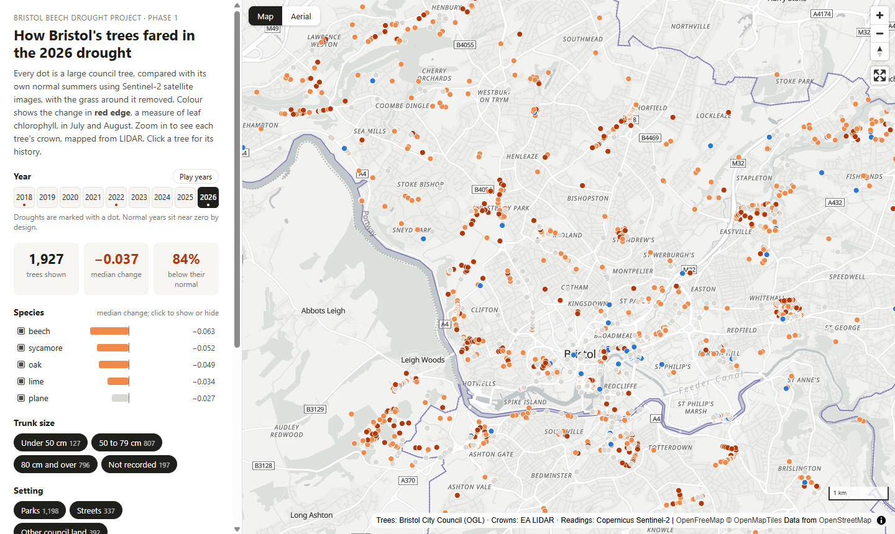](https://kasparszpoj-bit.github.io/bristol-beech-drought/)

| At a glance | |
|---|---|
| Skills | Satellite remote sensing (vegetation indices, cloud masking, mixed pixel correction) · LIDAR crown mapping · spatial databases and SQL · geoprocessing automation · statistics (bootstrap intervals, baseline comparison) · field survey design · web mapping · dashboard reporting · reproducible pipelines |
| Tools | PostgreSQL and PostGIS · QGIS (Graphical Modeler, three models run headless) · Python (pandas, matplotlib, psycopg, pytest) · MapLibre GL JS and GitHub Pages · Power BI (DAX) · QField · Git |
| Data | Sentinel-2 (243 images, 2018 to 2026) · Environment Agency 1 m LIDAR · council tree register (56,581 trees) · Met Office records · my own field survey |
| Scale | 8,623 crowns mapped from LIDAR; 1,927 analysable, 195 of them beech |
| Outputs | [Web map](https://kasparszpoj-bit.github.io/bristol-beech-drought/) · [Power BI report](#power-bi-report) · figures and this write-up |

## The tree that started it

My family's house in north Bristol had a large Victorian copper beech. Giant
polypore (*Meripilus giganteus*), a root rot that can topple a beech with
little warning, fruited at its base for three autumns, and after the dry
summer of 2026 it came up all around the tree. We have had to cut it down.
That raised the question this project asks across the city: how are
Bristol's big old beeches coping? The garden tree runs through the project
as a case study, and its exact location stays private.

## Key findings

I compared each tree with its own normal summers (2019 to 2021, 2023, 2024),
after removing the ground's share of every satellite reading.

1. **Beech was the only species clearly worse in 2026 than in 2018.** The
   same 195 beeches lost 0.012 more red edge, a measure of chlorophyll
   (95% interval 0.004 to 0.028). In 2026 beech fell most (−0.063), ahead
   of sycamore (−0.052), oak (−0.049), lime (−0.034) and plane (−0.027).
2. **Most trees coped no worse than in 2018,** although 2026 was hotter.
   84% of crowns read below normal, the highest share of any year, but the
   drop was shallow.
3. **The oldest beeches were not clearly worse** than mid-sized ones.
4. **Most of the raw satellite signal was grass.** Removing the ground
   around each crown changed the results.
5. **The garden tree lost more red edge than most large council beeches,**
   consistent with root decay but not proof of it.

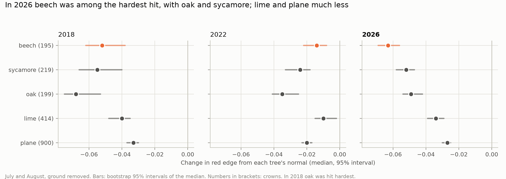

*Change in red edge from each tree's normal, by species, in three drought
years. Bars show 95% intervals.*

## Data

| Source | Gives |
|---|---|
| Bristol City Council tree register (ArcGIS REST) | Species, trunk size, crown size and site of every council tree |
| Sentinel-2 L2A (Earth Search on AWS) | 243 summer images, 2018 to 2026 |
| Environment Agency LIDAR Composite | 1 m canopy height, for crowns |
| OS OpenMap Local | Buildings and roads |
| Met Office station data | Rain and temperature at Yeovilton and Cardiff, 1964 to 2026 |
| Field survey (QField) | Crown condition of 41 randomly drawn trees |

Everything I found wrong with the register is in
[docs/data_quality_register.md](docs/data_quality_register.md).

## Method

1. **Trees:** load the council register into PostGIS and clean it in SQL.
2. **Crowns (QGIS model 01):** draw a crown for each large tree from LIDAR
   canopy height, remove roofs, split touching crowns.
3. **Readings (QGIS model 02):** mask cloud, then average greenness (NDVI),
   moisture (NDMI) and red edge (NDRE) over each crown, for all 243 images.
4. **Remove the ground (model 03 and SQL):** subtract the ground's share,
   using LIDAR canopy cover and a ring of ground around each crown.
5. **Compare each tree with its own normal,** using the July and August
   median. The known droughts of 2018 and 2022 test the method.
6. **Compare species and trunk sizes** with bootstrap intervals.

Full detail: [docs/methods.md](docs/methods.md).

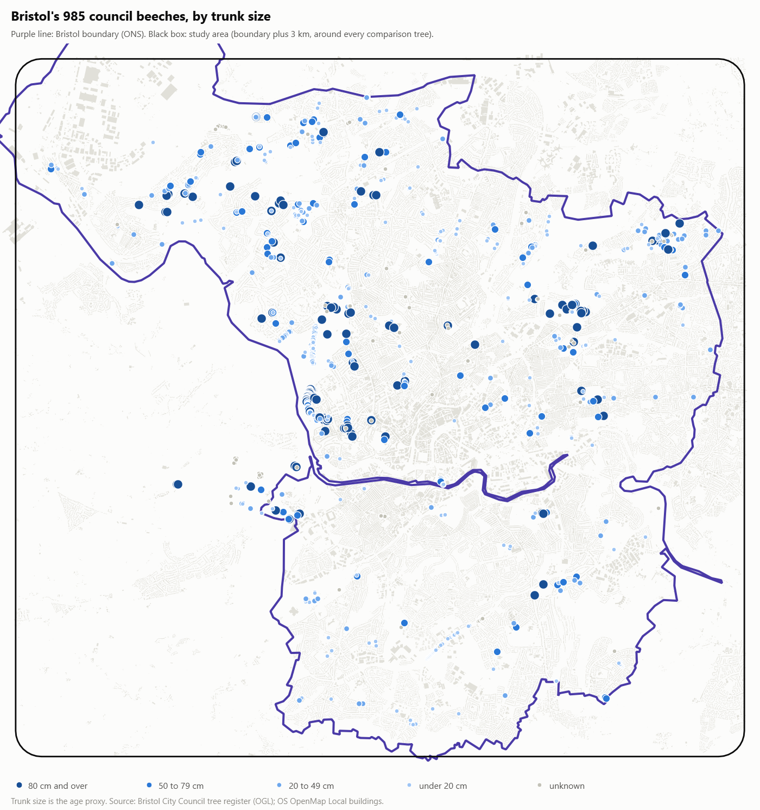

*Bristol's 985 council beeches by trunk size, with the study area.*

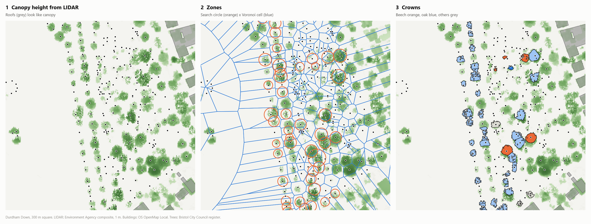

*Drawing crowns on Durdham Down: LIDAR canopy height (1), each tree's zone
(2), finished crowns (3).*

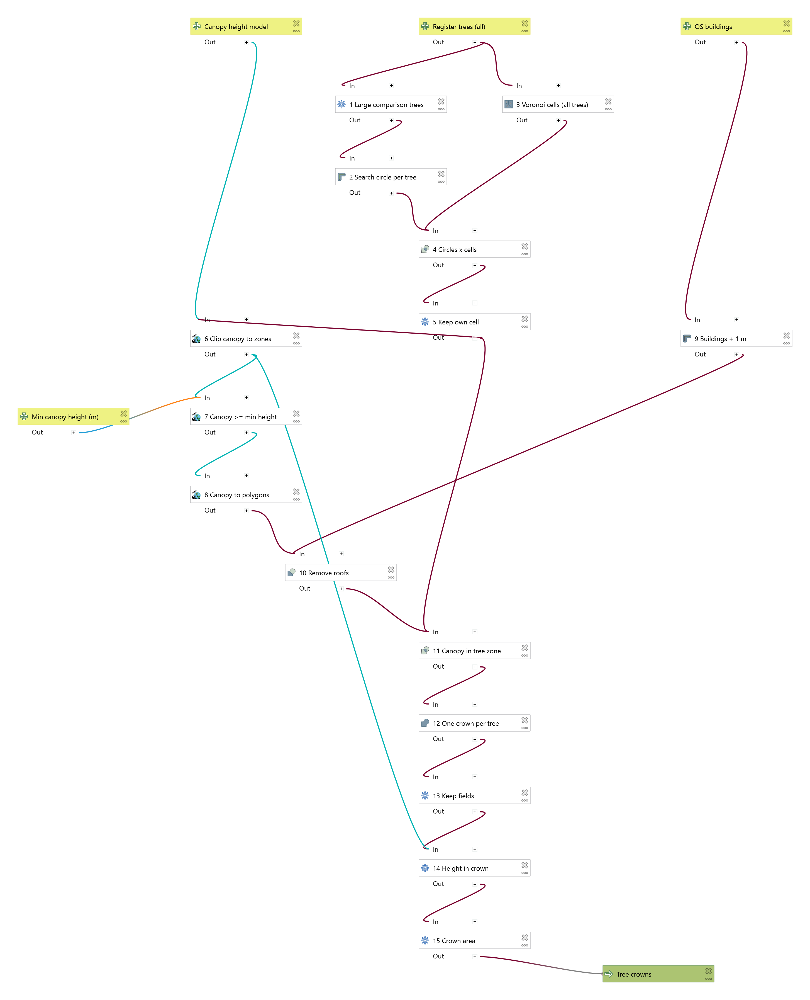

*QGIS model 01: 15 steps from LIDAR, register trees and buildings to
crowns.*

## Results

### 2026: heat on top of dryness

Summer rain alone did not set a record: 1976, 1995 and 2018 were drier. 2026
brought the hottest summer and driest July on record at both Yeovilton and
Cardiff, straight after a dry 2025.

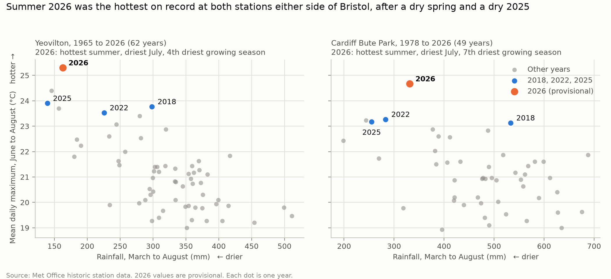

*Each dot is one year. 2026 sits alone in the hot, dry corner.*

### The method finds known droughts

2018 and 2022 both read below normal. 2026 matched 2018 in depth but put
more crowns below normal than any other year.

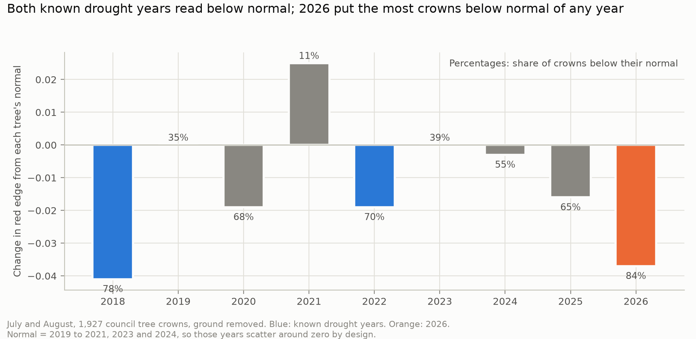

### Grass dominated the raw signal

A 10 m pixel takes in the ground around a crown, and dry grass loses five to
twenty times more greenness than trees. The raw readings made limes, with
the smallest crowns, look worst. With the ground removed, beech stood apart.

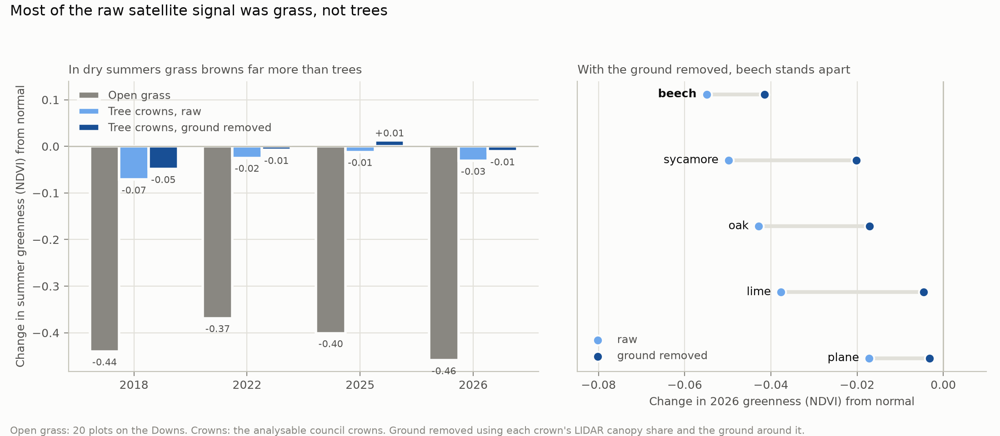

### Species and trunk size

Beech, sycamore and oak were hit hardest, lime and plane least. Among crowns
of similar canopy share, beech overlaps oak and sycamore, so "among the
hardest hit" is the fair claim. The biggest beeches showed no clear extra
stress.

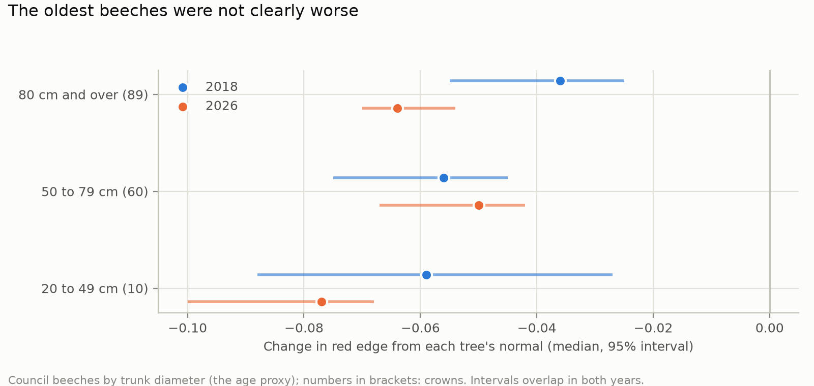

### The garden tree

I ran it through the same models. In 2026 its greenness fell −0.125 against
a median of −0.040 for the 89 largest council beeches, and its red edge
−0.099 against −0.064.

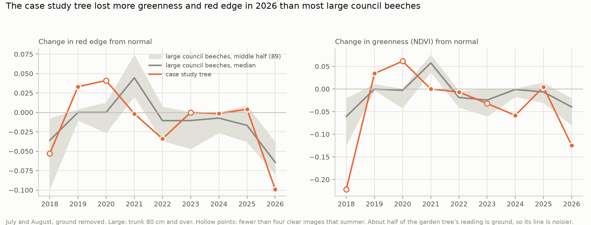

| When | What happened |
|---|---|
| 2017 | A main stem died and was removed |
| 2024 to 2026 | Giant polypore at the base each autumn |
| Summer 2026 | Severe drought and a heavy nut crop |
| September 2026 | Fruiting all around the base; a consultant arboriculturist advised the decay would progress |
| Autumn 2026 | Felled because of the fungus |

### Pilot field check

On 30 September 2026 I scored 41 randomly drawn trees on Clifton and
Durdham Downs with QField. Most were healthy: 8 of 39 showed visible stress.
The walk:

- **caught the raw readings** showing healthy trees as stressed, which led
  to the ground correction
- **agreed in direction** with the corrected readings (stressed trees read
  lower), on too few trees to confirm
- **tested the register:** 40 of 41 trees stood where it said, but one
  "live" 100 cm beech was a dead monolith ringed with giant polypore

## Web map

**[Open the map](https://kasparszpoj-bit.github.io/bristol-beech-drought/)**,
built with MapLibre and hosted on GitHub Pages. Step through 2018 to 2026,
filter by species, trunk size and setting, zoom in to see LIDAR crowns, and
click a tree for its history. It shows council trees only.

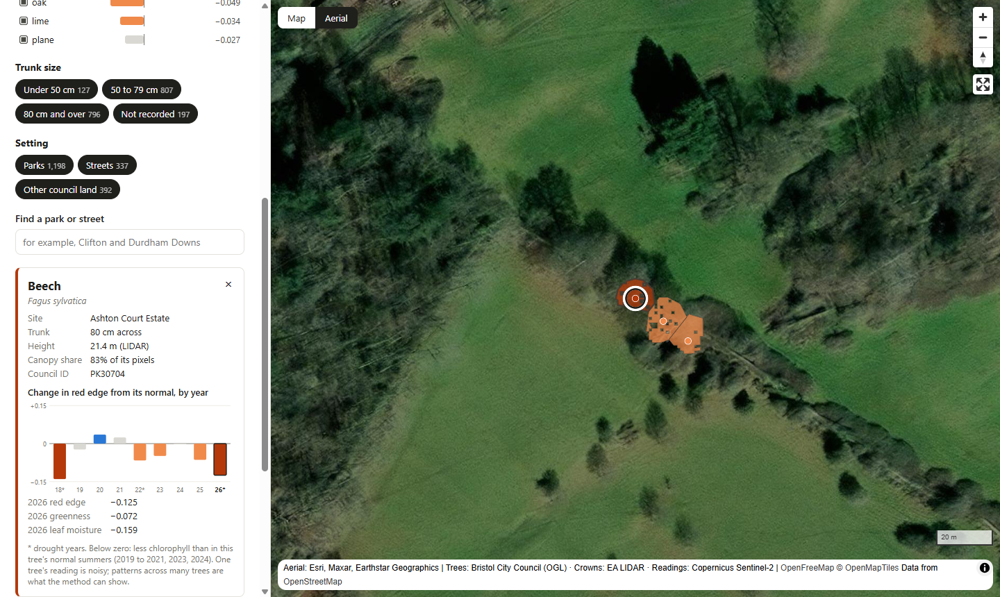

## Power BI report

Four pages, saved as a Power BI project in [powerbi/](powerbi/). Python
generates the pages, and I checked every number against the analysis with
DAX queries. [How to open it](powerbi/README.md).

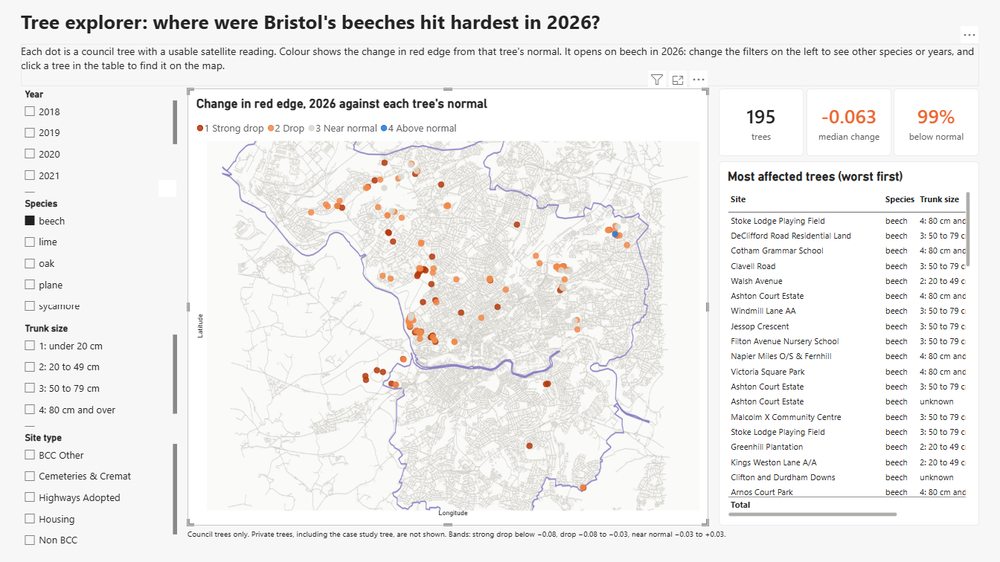
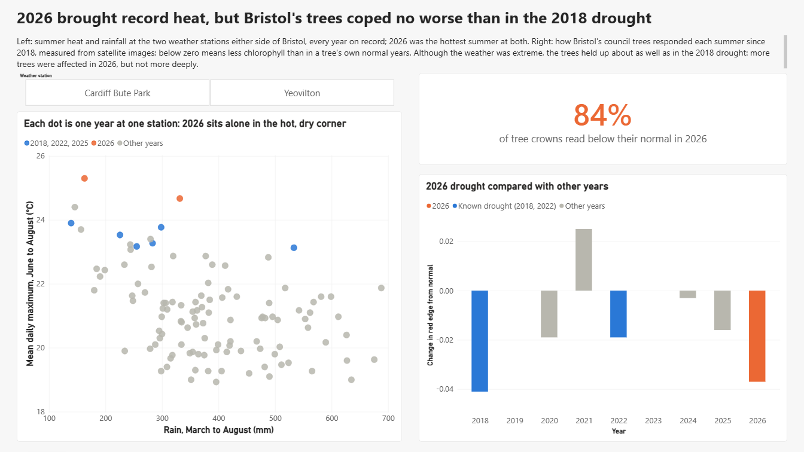
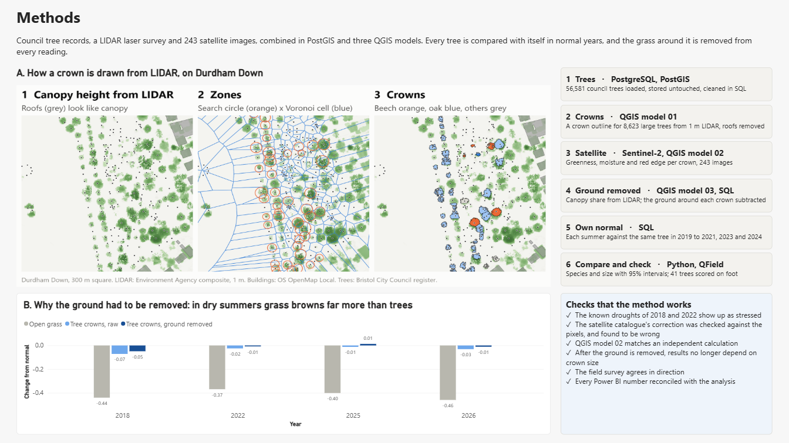
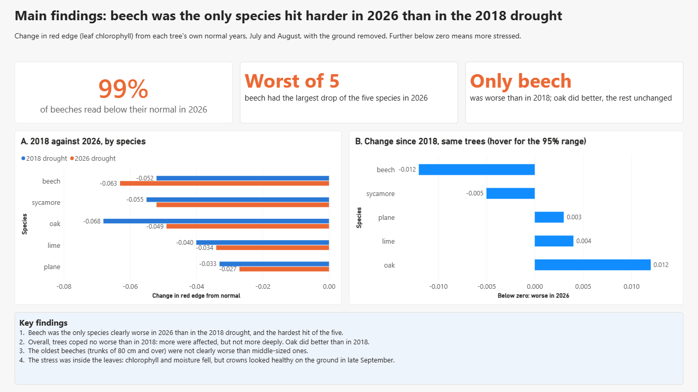

## Limitations

- At 10 m most crowns are a few mixed pixels. The ground correction removes
  most of the ground's influence, not all of it.
- The pilot field sample is small: 39 trees, 4 of them stressed.
- Trunk sizes are partly estimated, so I use broad classes only.
- Watering, soils and a LIDAR survey older than 2026 all add noise. Nothing
  here shows why a tree was stressed.
- This is not an arboricultural safety assessment.
- The 2026 weather values are provisional.

## Decisions and trade-offs

- **Raw data kept untouched, cleaned in published SQL,** so every number
  traces back.
- **Trees keyed on ASSET_ID:** the council regenerated every OBJECTID
  between two downloads.
- **Known droughts as a test:** if 2018 and 2022 had not read as stressed,
  the method would be wrong.
- **Pixels checked, not just the catalogue:** the catalogue's −0.1 offset
  had already been applied, and applying it again would have corrupted
  every image from June 2018.
- **The older Sentinel-2 archive:** the reprocessed one has no 2022 images
  over Bristol.
- **Each tree against itself,** so a copper beech never gets compared with a
  green one.
- **Like with like:** comparing crowns of similar canopy share turned
  "hardest hit" into "among the hardest hit".
- **QGIS models as code,** run headless, so they rerun with one command.
- **Joins checked:** Power BI read IDs as numbers and dropped most readings,
  and a distinct count caught it.
- **Field trees drawn at random,** so a match with the satellite means
  something.

Every step and its reasoning: [docs/project_log.md](docs/project_log.md).

## Phase 2: ground truth and giant polypore cases

October 2026 to summer 2027.

1. Finish the random field sample (41 of 61 scored) and test whether
   stressed trees read lower on the satellite.
2. Find real giant polypore cases (NBN Atlas, FixMyStreet reports, field
   sightings) and test whether they show the garden tree's signal. The
   first: a beech in St Andrews Park (PK31500), found on 2 October 2026.
3. Rank large stressed beeches near roads and buildings for a tree officer.
4. Group trees by how they responded from 2018 to 2026.
5. Add a Power BI page on the ground truth.
6. Rescore the field sample in 2027, since beech often shows drought damage
   a year late.

## Reproduce it

Requires PostgreSQL 17 with PostGIS, QGIS 4 and Python 3.14. The database
password comes from your pgpass file.

```bash
python -m venv .venv && .venv/Scripts/pip install -e ".[dev]"
beech-ingest-register                  # register and boundary into PostGIS, all SQL applied
python -m beech.ingest_weather         # Met Office stations
python -m beech.sentinel               # Sentinel-2 catalogue
python -m beech.s2_download            # study-area windows of 243 images (about 2 GB)
python -m beech.lidar                  # LIDAR tiles and canopy height model
python -m beech.ingest_os              # OS buildings and roads
python -m beech.run_models             # QGIS model 01: crowns
beech-crown-indices                    # QGIS model 02: readings per crown (about 75 min)
beech-canopy-cover                     # canopy share per crown
beech-ground-reference                 # QGIS model 03: ground around each crown
beech-grass-reference                  # open grass plots
beech-apply-sql 09_metrics.sql 10_field_vs_satellite.sql 11_unmixed.sql
python -m beech.qfield                 # freeze the random field sample
beech-load-field-returns <folder>      # QField survey returns
beech-analysis                         # comparison tables, outputs/tables/
python -m beech.figures                # figures, outputs/figures/
beech-web-export                       # web map data, web/data/
beech-powerbi-export                   # Power BI data, powerbi/data/
beech-powerbi-report                   # Power BI pages (close Power BI first)
pytest                                 # tests
```

## In this repo

[web/](web/) map · [powerbi/](powerbi/) report · [qgis/](qgis/) models ·
[sql/](sql/) database and cleaning · [src/beech/](src/beech/) Python
pipeline · [docs/](docs/) methods, data quality, field protocol, project
log · [outputs/](outputs/) figures and tables · [qfield/](qfield/) field
project · [tests/](tests/)

## Data credits

Contains Bristol City Council data licensed under the Open Government
Licence v3.0. Contains modified Copernicus Sentinel data (2018 to 2026),
accessed through Earth Search on AWS. Contains Environment Agency LIDAR
Composite data, Open Government Licence v3.0. Contains OS data © Crown
copyright and database right 2026 (OS OpenMap Local), Open Government
Licence v3.0. Contains Met Office historic station data. Source: Office for
National Statistics licensed under the Open Government Licence v3.0 (local
authority boundary). Web map basemap: OpenFreeMap, © OpenMapTiles, data ©
OpenStreetMap contributors. Aerial imagery: Esri, Maxar, Earthstar
Geographics.
